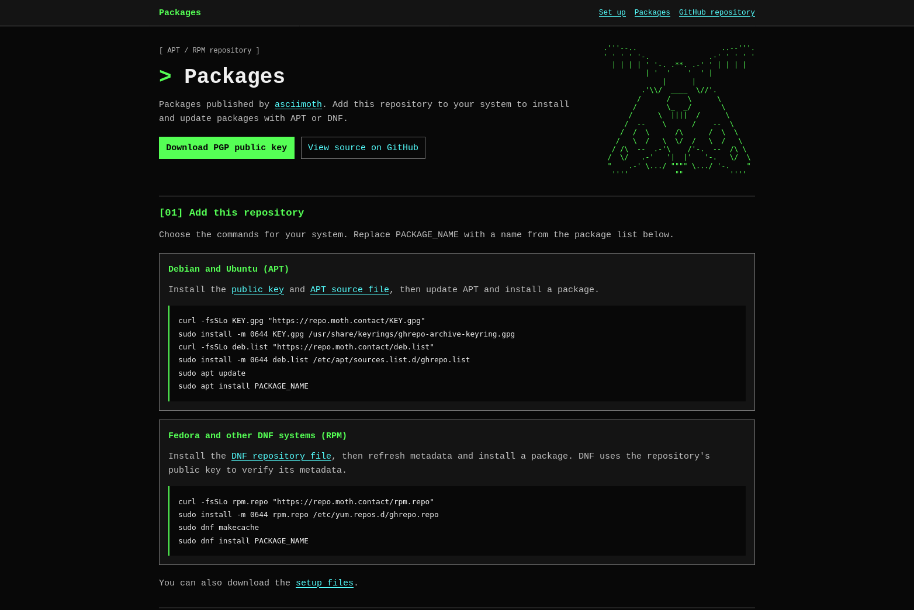
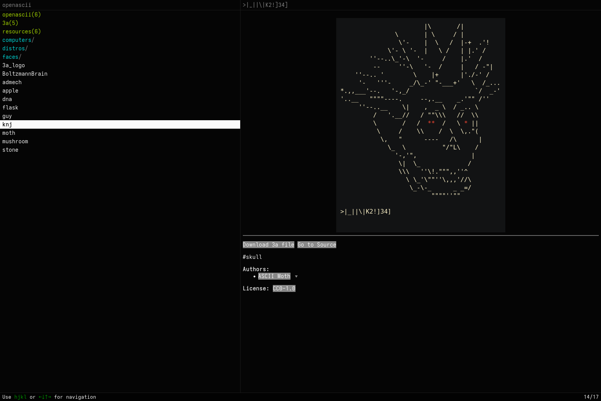

  

    Coder, sometimes <a href="https://openascii.moth.contact/?author=asciimoth#apple">artist</a>
  

   
  
    
  
  
    |_||\\|K2!\]34\" />
  
   
  
<!--START_SECTION:prlist-->
<!--END_SECTION:prlist-->
  

### Some of my projects
#### Major

<!-- - [almagest](https://github.com/asciimoth/almagest) - visual network toolkit built around a node graph -->
<!---->
<!--    -->
<!---->
- [zpg](https://github.com/asciimoth/zpg) - Standalone cli supervisor for [zig progress protocol](https://andrewkelley.me/post/zig-new-cli-progress-bar-explained.html)
  - Client libs: [zppy](https://github.com/asciimoth/zppy) [zpgo](https://github.com/asciimoth/zpgo) [zprs](https://github.com/asciimoth/zprs) [zpjs](https://github.com/asciimoth/zpjs)

  

- [ghrepo](https://github.com/asciimoth/ghrepo) - host DEB and RPM repositories on GitHub Pages
    - [repo](https://repo.moth.contact/) - personal DEB and RPM package repository

  

- [openascii](https://github.com/asciimoth/openascii) - open source ASCII art archive
  - [3a](https://github.com/asciimoth/3a) - animated ASCII art file format
  - [aaa](https://github.com/asciimoth/aaa) - command-line tools for creating and viewing 3a art
  - [rs3a](https://github.com/asciimoth/rs3a), [py3a](https://github.com/asciimoth/py3a), and [go3a](https://github.com/asciimoth/go3a) - 3a libraries for Rust, Python, and Go
  - [convert3a](https://github.com/asciimoth/convert3a) and [rsw3a](https://github.com/asciimoth/rsw3a) - 3a conversion tools

  

#### Minor

- [killswitch](https://github.com/asciimoth/killswitch) - Linux eBPF network kill switch
- [p-mark](https://github.com/asciimoth/p-mark) - mark Linux processes for split routing
- [gonnect](https://github.com/asciimoth/gonnect) - network helpers and common types for Go
    - [gonnect-netstack](https://github.com/asciimoth/gonnect-netstack) - gVisor network stack integration for gonnect
    - [gonnect-vpn-example](https://github.com/asciimoth/gonnect-vpn-example) - point-to-point VPN example using gonnect
- [socksgo](https://github.com/asciimoth/socksgo) - SOCKS client and server library for Go
- [mullvad-split-tunnel-go](https://github.com/asciimoth/mullvad-split-tunnel-go) - Go controller for Mullvad's Windows split tunneling driver
- [sysnet-linux](https://github.com/asciimoth/sysnet-linux) - Linux networking backend for gonnect VPNs
- [sysnet-windows](https://github.com/asciimoth/sysnet-windows) - Windows networking backend for gonnect VPNs
- [tor-driver](https://github.com/asciimoth/tor-driver) - Tor daemon driver library for Go
- [wgo](https://github.com/asciimoth/wgo) - WireGuard library for Go
    - [wg-web-demo](https://github.com/asciimoth/wg-web-demo) - browser demo of HTTP over WireGuard
    - [wgo-tailscale](https://github.com/asciimoth/wgo-tailscale) - Tailscale control plane for wgo
- [ygg](https://github.com/asciimoth/ygg) - alternative Yggdrasil mesh network implementation
- [tuntap](https://github.com/asciimoth/tuntap) - cross-platform TUN device library
- [batchudp](https://github.com/asciimoth/batchudp) - batched UDP transport package
- [goeris](https://github.com/asciimoth/goeris) - [ERIS](https://eris.codeberg.page) go library
- [pasta](https://github.com/asciimoth/pasta) - framework for node graph editors and runtimes
- [formular](https://github.com/asciimoth/formular) - message format for dynamic menus and forms
- [pineentry](https://github.com/asciimoth/pineentry) - GPG pinentry caching proxy
- [errata](https://github.com/asciimoth/errata) - code snippet annotation library and tool
- [gobox](https://github.com/asciimoth/gobox) - subprocess sandbox abstraction
- [ident](https://github.com/asciimoth/ident) - RFC 1413 implementation
- [putback](https://github.com/asciimoth/putback) - return read bytes to an I/O stream

